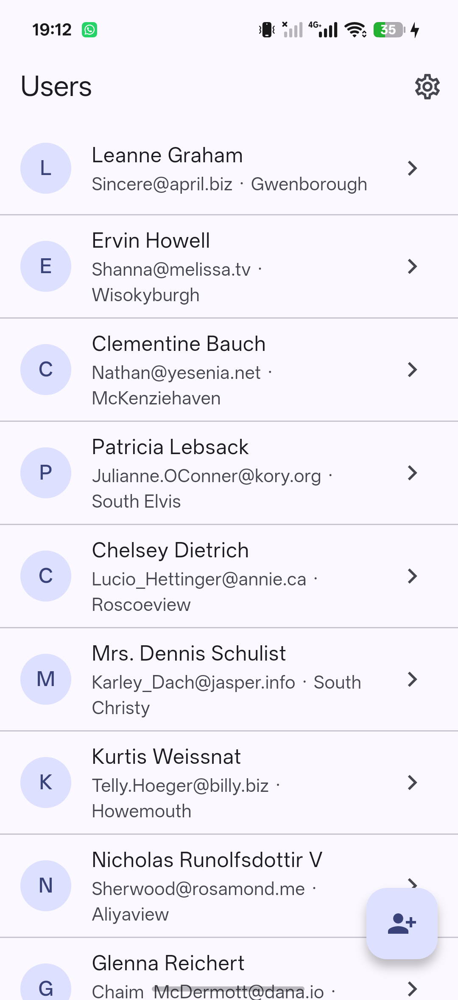
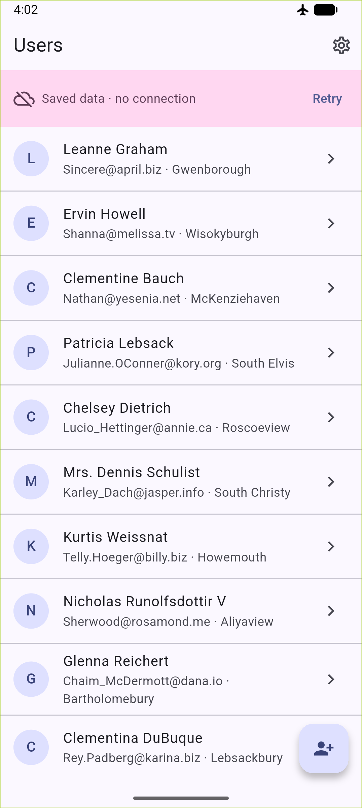

# Users - a Flutter REST client

A multi-screen users directory for Android: a real REST API, provider state management, an offline cache, secure token storage, camera/gallery profile photo, and a signed release.

|  |  |
|---|---|
| Users list over the network | Saved data when the API is unreachable |

## Run it

```bash
cd practices/practice_14/users_api
flutter pub get
flutter run
flutter run --dart-define=USE_FAKES=true
flutter run --dart-define-from-file=env/local.json
flutter build apk --release --dart-define-from-file=env/prod.json
```

Release APK (arm64): [v1.0.1](https://github.com/Dauserr/flutter-2026-serikbayev-daulet/releases/tag/v1.0.1) - install on an Android phone.

## Architecture (five lines)

- `features/<name>/` - screen, ChangeNotifier, repository, per feature
- `core/api/` - ApiClient: `Uri.https`, 10 s timeout, sealed `ApiException`
- repositories behind interfaces; fakes for tests and `USE_FAKES`
- storage: `shared_preferences` for settings, secure storage for a token, a file cache for users
- `flutter test`: 10 tests - models, error mapping, one widget test

## Source

The app lives in [`practices/practice_14/users_api`](practices/practice_14/users_api). Other practices in this course repository are the weekly labs.

## Team

| Area | Owner | Reviewer |
|---|---|---|
| All features | Daulet Serikbayev | Course reviewer |
