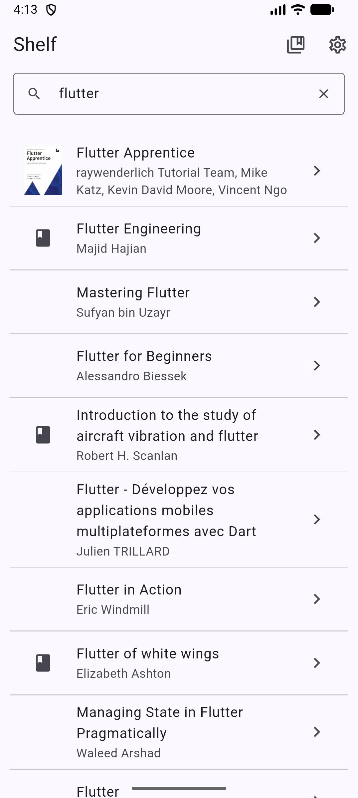
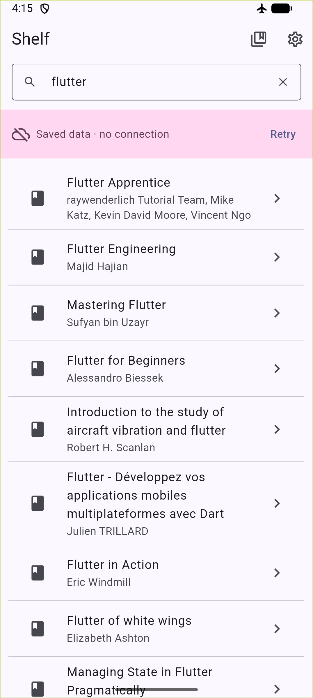

# Shelf - a reading tracker REST client

A Flutter app for finding books through the Open Library API and keeping a personal reading shelf through a hosted CRUD collection.

|  |  |
|---|---|
| Open Library search results | Saved catalogue when the API is unreachable |

## Run it

```bash
flutter pub get
flutter run
flutter run --dart-define=USE_FAKES=true
flutter run --dart-define-from-file=env/local.json
flutter build apk --release --dart-define-from-file=env/prod.json
```

Release APK (arm64): local archive `releases/1.0.1+2` - build `1.0.1 (2)`.

## Architecture (five lines)

- `features/<name>/` - screen, ChangeNotifier, repository and per-feature widgets
- `core/api/` - one `ApiClient` for Open Library, one for the shelf service; `Uri.https`, 10 s timeout, sealed `ApiException`
- repositories behind interfaces; `FakeBookRepository` and `FakeShelfRepository` for tests and `USE_FAKES`
- storage: `shared_preferences` settings, secure storage token, `books.json` cache in Documents
- `flutter test`: 17 tests - models, error mappings, repositories and two widget tests

## Team

| Area | Owner | Reviewer |
|---|---|---|
| Catalogue | Daulet Serikbayev | self-review |
| Shelf CRUD and form | Daulet Serikbayev | self-review |
| Core and tests | Daulet Serikbayev | self-review |
| Release | Daulet Serikbayev | self-review |

The pair workflow is not simulated; see `TEAM.md`.

## Decisions

- The catalogue is Open Library search, not a hard-coded list, so search is a server query rather than a local filter. - Daulet
- The shelf is a separate resource on `api.restful-api.dev`; the app does not pretend that a local list is the server. - Daulet
- Two API clients share one secure store but have separate hosts, which keeps the host names out of repositories. - Daulet
- `BookCache` stores only the last good catalogue; the shelf is never cached because it is user-owned server data. - Daulet
- The catalogue keeps one `CatalogueModel`; the screen watches it and the repository owns the HTTP path. - Daulet
- The shelf count badge uses `select`, because the other widgets must not rebuild for an unrelated shelf change. - Daulet
- The form uses `PopScope`, because a dirty form is a user decision, while Save is an explicit exit. - Daulet
- `USE_FAKES=true` switches both repositories, so the defence works with the Wi-Fi off. - Daulet

## Requirements checklist

- [x] `applicationId` is `kz.serikbayev.shelf`; version is `1.0.1+2`.
- [x] Release APK built with split ABI, obfuscation and archived symbols; signed with the upload key.
- [x] `key.properties` and `*.jks` are ignored; no secret in history.
- [x] `Env` is the only `fromEnvironment` file; About shows version, mode, environment and both hosts.
- [x] Icon, Android 12 splash, app name and `INTERNET` permission.
- [x] Token in secure storage; settings in `shared_preferences`; catalogue cache in Documents.
- [x] Four states in both lists; catalogue search and pull-to-refresh; 600 px grid.
- [x] Shelf create/edit/delete with confirmation; form validation, dropdown, date picker, `PopScope`.
- [x] Profile photo permissions and About/licences.
- [x] Ten-plus offline tests; `flutter analyze`, `dart format .` and layer check pass.
- [ ] Two GitHub Releases v1.0.0/v1.0.1 and pair PR review are not completed; this is a solo submission.

## Quality checklist

```text
$ flutter analyze
No issues found!

$ dart format .
(no diff)

$ flutter test
17 tests passed

$ bash tool/check_layers.sh
(no output)
```
